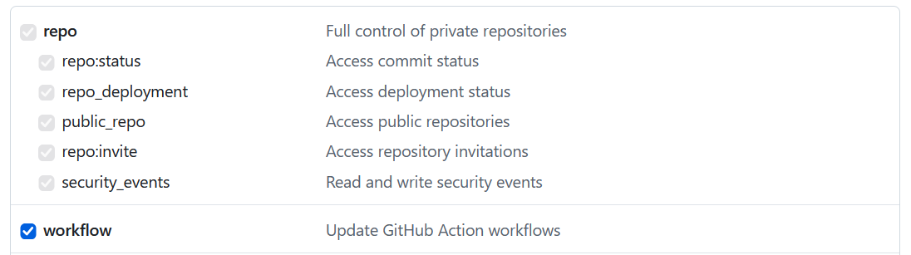
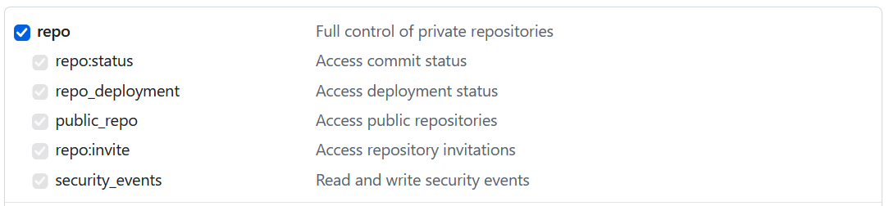
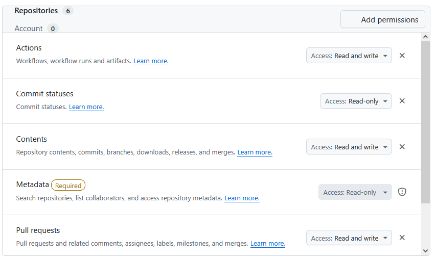
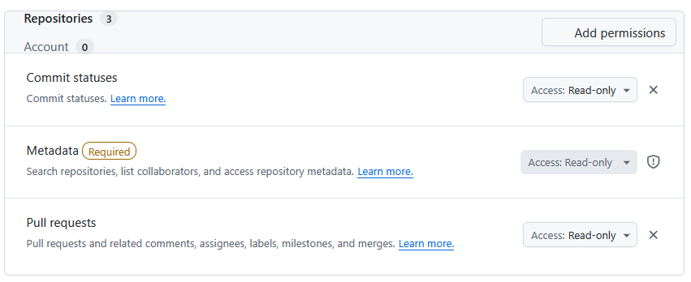

# GitHub token scopes

ralphus talks to GitHub with two kinds of personal access token (classic),
and they need **different** scopes:

| Token | Set with | Used for | Scopes |
|---|---|---|---|
| **User token** | `ralphus user set-forge-token <user> --host github.com --token …` (or `RALPHUS_GITHUB_TOKEN`, or a cached `gh auth login`) | Everything a user does: pushes, PRs, comments, labels, stacks, cancelling CI, exhibit uploads | `repo` + `workflow` |
| **Poll-pool token** | `ralphus forge pool add github <label> --token …` | Read-only background polling only | `repo` for private repositories; **none** for public-only |

The token resolution order and the poll-pool rotation are described in
`daemon/src/forge.rs`'s module doc and `daemon/src/forge_pool.rs`.

## User token

Tick these on the "New personal access token (classic)" page:

- **`repo`** — the whole box, which includes `repo:status`, `repo_deployment`,
  `public_repo`, `repo:invite` and `security_events`.
- **`workflow`**

Leave everything else unticked. ralphus does not call any org, user-profile,
key, hook, package, gist, notification, project, codespace, Copilot or
enterprise endpoint, so `admin:*`, `write:packages`, `user`, `gist`,
`delete_repo` and the rest are never needed.

### Why `repo`

Every GitHub call ralphus makes is under `/repos/{owner}/{repo}/…` or the bare
`/user` "who am I" check:

| What ralphus does | Endpoint |
|---|---|
| Create, find, read, retarget, rename, close a PR | `POST/GET/PATCH /repos/{r}/pulls[/{n}]` |
| Post and read PR comments | `/repos/{r}/issues/{n}/comments`, `/repos/{r}/pulls/{n}/comments` |
| Add/remove labels (e.g. `ralphus:defer-full-ci`) | `/repos/{r}/issues/{n}/labels[/{name}]` |
| Keep GitHub's native PR stack in sync | `/repos/{r}/stacks[/{n}[/add\|/unstack]]` |
| Read CI results | `/repos/{r}/commits/{sha}/status`, `/repos/{r}/commits/{sha}/check-runs` |
| Read and cancel Actions runs, read job logs | `/repos/{r}/actions/runs`, `/repos/{r}/actions/runs/{id}/force-cancel`, `/repos/{r}/actions/jobs/{id}[/logs]` |
| Read the PR template, repository id | `/repos/{r}/contents/{path}`, `/repos/{r}` |
| Upload live-action exhibits (screenshots, GIFs) into PR descriptions | GitHub's `user-attachments` upload, keyed by the repository id |
| Check the token works (`ralphus user check-forge-token`) | `GET /user` (needs no scope) |
| Push review branches over HTTPS | `git push`, with the token handed to git through ralphus's credential helper |

For **private** repositories, GitHub only allows any of that with `repo`.
For **public-only** repositories `public_repo` covers PRs, comments and labels,
but GitHub documents the Actions run-cancel endpoint as requiring `repo` for
classic tokens, so ralphus's CI-cancelling (superseded runs, deferred CI)
would fail. Use `repo` either way.

### Why `workflow`

ralphus pushes a review's branches to GitHub over HTTPS with the user token.
GitHub rejects any push containing a commit that adds, edits or deletes a file
under `.github/workflows/` unless the token has `workflow` — `repo` alone
allows pushing everything else, but not that. Agents routinely touch CI files
(for example, adding a test step to `.github/workflows/ci.yml`), and because a
review's branches are pushed as a stack, one rejected branch can leave the
push stopped partway through.

If you are certain no ralphus task will ever edit workflow files you can omit
it, but you only find out when a push is rejected, so it is recommended.

A poll-pool token never pushes, so it never needs `workflow`.

## Poll-pool token

Pool tokens exist only to spread GitHub's rate limit across more accounts.
`forge.rs`'s `poll_rotated` uses them for exactly four read paths:

- PR mergeability and base branch/base state (`GET /repos/{r}/pulls/{n}`)
- PR CI status (`GET /repos/{r}/commits/{sha}/status` and `…/check-runs`)
- the PR comment cache refresh (`GET /repos/{r}/issues/{n}/comments`,
  `GET /repos/{r}/pulls/{n}/comments`)

Every write — creating/updating PRs, comments, labels, the stack API,
cancelling runs, uploads, pushes — always uses the acting user's own token,
because a write must be attributable to a person and pool tokens belong to
nobody.

So a pool token needs **read access to the repository and nothing else**:

- **Private repositories:** `repo`. Classic tokens have no read-only private-repo
  scope, so this unavoidably grants write too; ralphus will not use it for
  writes, but the token itself can. A read-only
  [fine-grained token](#fine-grained-tokens) is the least-privileged
  alternative if your organization allows them.

  
- **Public repositories only:** **no scopes at all.** A classic token with
  every box unticked still authenticates (which is what lifts the rate limit
  from 60 to 5,000 requests/hour) and can read any public repository.

Do not tick `workflow` or anything else for a pool token.

## Fine-grained tokens

Fine-grained tokens set per-repository permissions instead of scopes. The
tightest settings for each token follow; the permission names come from
GitHub's documented requirements for each endpoint above.

For both tokens:

- **Resource owner:** the account or organization that owns the repository.
  An organization may have to allow or approve fine-grained tokens first.
- **Repository access:** "Only select repositories" — the project's
  repositories, plus your fork if you use [fork routing](fork-workflows.md).
- Every permission not listed below stays at **No access**, and every
  account permission stays at **No access**.

### User token

| Repository permission | Level | Why |
|---|---|---|
| Metadata | Read-only (set automatically) | Repository lookup |
| Contents | Read and write | `git push`, reading the PR template |
| Workflows | Read and write | Pushing changes to `.github/workflows/`; replaces the classic `workflow` scope |
| Pull requests | Read and write | Opening and updating PRs, comments, labels, PR stacks |
| Actions | Read and write | Listing and cancelling CI runs, reading job logs |
| Commit statuses | Read-only | CI status |

### Poll-pool token

Private repositories:

| Repository permission | Level |
|---|---|
| Metadata | Read-only (set automatically) |
| Pull requests | Read-only |
| Commit statuses | Read-only |

Public repositories only: choose "Public Repositories (read-only)" and add no
permissions.

Unlike a classic pool token, a fine-grained one is genuinely read-only.

### Not confirmed

- **Check runs:** fine-grained personal tokens have no *Checks* permission
  (GitHub offers it to GitHub Apps only), so whether
  `GET /repos/{r}/commits/{sha}/check-runs` answers for a fine-grained token
  is unverified. The commit-status half of CI status (*Commit statuses*) is
  unaffected.
- **PR stacks:** GitHub's stacks API is new; it is assumed to use the
  *Pull requests* permission.
- **Exhibit uploads:** these go through an upload endpoint GitHub does not
  document, so fine-grained tokens may not work for them at all. If uploads
  fail with a fine-grained user token, use a classic one.

## Same or different?

Different. The user token needs `repo` + `workflow` because it writes and
pushes. A pool token only reads, so it needs `repo` for private repositories
and no scopes at all for public ones — never `workflow`.

## Checking a token

- User token: `ralphus user check-forge-token <user> github.com` reports
  whether the stored token authenticates and as whom. It does not check
  scopes; a missing scope shows up as a `403`/`404` on the first call that
  needs it (a `404` is how GitHub answers a private repository the token
  cannot see).
- To see a token's scopes directly:
  `curl -sI -H "Authorization: Bearer <token>" https://api.github.com/user | grep -i x-oauth-scopes`
